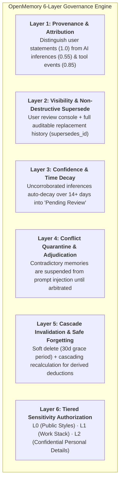

<div align="center">

# 🧠 OpenMemory

**Universal, Local-First AI Memory Governance & Provenance Hub**

[](LICENSE)
[](https://www.python.org/)
[](https://modelcontextprotocol.io/)
[](docs/LOCAL_FIRST.md)
[](docs/LOCAL_FIRST.md)

*Every AI tool tries to "store and retrieve" your context. Nobody handles "auditing, correcting, decaying, and forgetting".*

[📖 中文详细使用说明](docs/USER_MANUAL.md) | [Architecture Whitepaper](docs/ARCHITECTURE.md) | [MCP Guide](docs/MCP_GUIDE.md) | [100% Local-First Guide](docs/LOCAL_FIRST.md)

</div>

---

## 💡 Why OpenMemory?

Modern AI agents (Cursor, Claude Desktop, Windsurf, Cline, Codex) suffer from the **"Memory Amnesia & Hallucinated Dogma"** dilemma:
1. **No Auditing**: You never know *why* an AI thinks you like something, or which chat session caused that deduction.
2. **Cannot Correct**: When an AI deduces an incorrect habit about you, changing it is nearly impossible.
3. **Zombie Conclusions**: When past code or habits change, obsolete AI memories persist indefinitely and corrupt future suggestions.
4. **Vendor Lock-in**: Your memory is fragmented across individual proprietary cloud subscriptions.

**OpenMemory** introduces an **Enterprise 6-Layer Memory Governance Engine** with a standardized **Model Context Protocol (MCP)** interface that runs **100% offline locally**, syncs via **Git/Markdown vaults**, or self-hosts on **Docker/NAS/VPS**.

---

## 🏛️ The 6-Layer Memory Governance Engine



---

## 🚀 3 Deployment Modes: Choose What Fits You

| Mode | Network Requirement | Server Needed? | Best For |
|---|---|---|---|
| **1. 100% Local-First** | 🚫 Zero / Fully Offline | ❌ No | Single developer, total privacy, sub-millisecond response |
| **2. Markdown & Git Vault** | 🚫 Offline or Git Sync | ❌ No | Syncing across laptops via Obsidian, Git, iCloud, or OneDrive |
| **3. Self-Hosted Hub** | 🌐 LAN or Tailscale | 🐳 Docker / VPS / NAS | Multi-agent team, shared cross-device central memory repository |

---

## ⚡ Quickstart in 60 Seconds

### Step 1: Clone & Setup
```bash
git clone https://github.com/1056121380/openmemory.git
cd openmemory

# On Windows:
scripts\setup.bat

# On Linux / macOS:
chmod +x scripts/setup.sh && ./scripts/setup.sh
```

### Step 2: Connect Your AI Assistant (Cursor / Claude / Windsurf)

The interactive wizard configures your IDE automatically. Alternatively, add this single block to your `.cursor/mcp.json` or `claude_desktop_config.json`:

```json
{
  "mcpServers": {
    "openmemory": {
      "command": "python",
      "args": ["/path/to/openmemory/client/mcp_server.py", "--mode", "local"]
    }
  }
}
```

That's it! Your AI assistant now automatically recalls your preferences, cites provenance evidence, and respects your privacy tiers.

---

## 🛠️ MCP Tools Overview

When connected via MCP, your AI assistant receives the following governance tools:

- `recall_memories(query, topic, max_sensitivity)`: Query active memories with confidence decay & sensitivity bounds.
- `record_memory(statement, category, source_type, sensitivity, evidence)`: Record new facts with provenance tracking.
- `correct_memory(old_memory_id, new_statement, reason)`: Supersede an outdated memory without erasing audit history.
- `reinforce_memory(memory_id, snippet)`: Corroborate an existing fact and boost its confidence.
- `forget_memory(memory_id, reason)`: Soft-delete or cascade-forget memories.
- `get_governance_stats()`: Inspect system health, pending conflict adjudications, and decay metrics.

---

## 📓 Syncing via Obsidian & Git Vaults

You don't need a cloud server to synchronize memories between multiple computers. Export your memories to an Obsidian-compatible Markdown vault:

```bash
# Export to human-readable Markdown vault
python client/export_import.py export --format vault -o ./my_memory_vault

# Export to portable JSON bundle
python client/export_import.py export --format json -o ./backup.json

# Import into another machine
python client/export_import.py import -f ./backup.json
```

Every Markdown file contains standard YAML frontmatter:
```markdown
---
id: mem_20261103_a1b2
category: preference
confidence: 0.95
sensitivity: L0
source_type: direct_statement
status: active
created_at: 2026-11-03T12:00:00Z
---
# Python Formatting Rule
Strictly use Ruff and Black for Python formatting; never use semicolons.
```

---

## 🐳 Self-Hosted Server & Web Review Console

For users wanting a centralized web review dashboard and team REST API:

```bash
docker compose up -d
```
Visit `http://localhost:8080` to access the **Web Review Console**:
- 🔍 **Live Search & Filter**: Filter by status (`active`, `conflicted`, `pending_review`), sensitivity (`L0` ~ `L2`), and source type.
- ⚖️ **Conflict Arbitration**: One-click supersede, scenario split (`work` vs `personal`), or synthesized rewrite.
- 📜 **Full Audit Stream**: Every creation, reinforcement, and supersession is logged with timestamp and operator.

---

## 🔒 Privacy & Sanitization Guarantee

OpenMemory is built with strict privacy-by-design:
- **Zero Telemetry**: No third-party tracking, analytics, or background telemetry.
- **Built-in Session Scrubber** (`client/sync.py`): Automatically scrubs API keys (`sk-*`, `ghp_*`), Bearer tokens, private IPv4 addresses, and passwords before saving.
- **Tiered Sensitivity (L0/L1/L2)**: Protects confidential personal context from leaking into casual coding sessions.

---

## 📖 Documentation

- [**📖 详细使用说明手册 (User Manual - 从小白配置到日常范例)**](docs/USER_MANUAL.md)
- [Architecture Whitepaper (Six Layers in Depth)](docs/ARCHITECTURE.md)
- [MCP Integration Guide (Cursor, Claude, Windsurf, Cline, Codex)](docs/MCP_GUIDE.md)
- [100% Local-First Guide](docs/LOCAL_FIRST.md)
- [Self-Hosted Deployment (Docker, VPS, NAS, Tailscale)](docs/SELF_HOSTED.md)

---

## 📄 License

Distributed under the [PolyForm Noncommercial License 1.0.0](LICENSE).
- ✅ Free for personal use, learning, research, and non-commercial development.
- ❌ Commercial use, SaaS hosting for profit, or commercial redistribution is strictly prohibited without explicit authorization.
