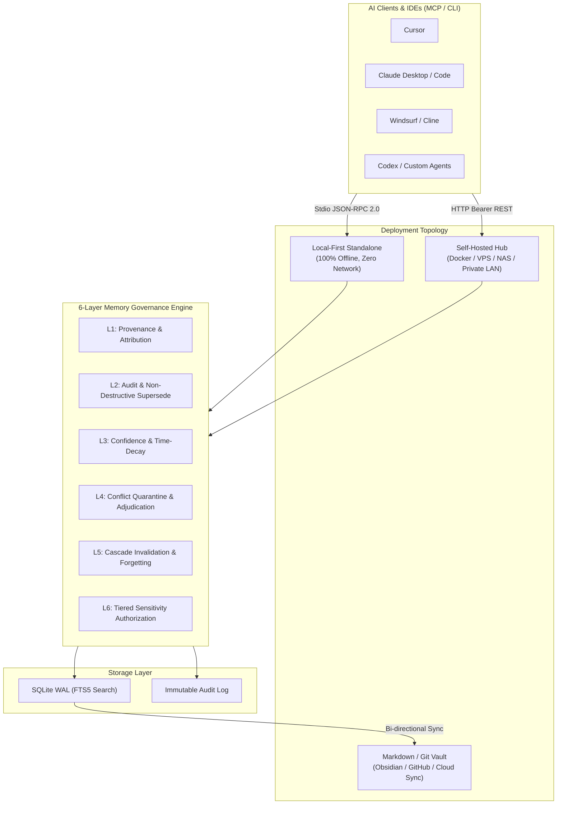
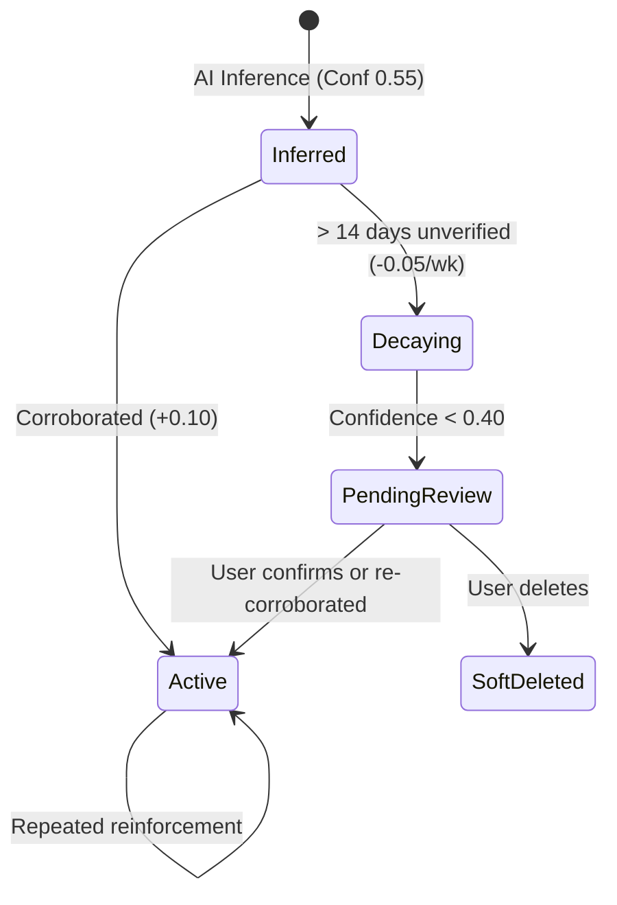

# OpenMemory Architecture Whitepaper

OpenMemory is a decentralized, local-first **Personal AI Memory Governance Hub**. It solves the fundamental flaw of first-generation AI memory tools that only focus on *"storing and retrieving"* without addressing *"auditing, correcting, decaying, and forgetting"*.

---

## 1. System Topology

---

## 2. The 6-Layer Governance Engine

### Layer 1: Provenance & Attribution (溯源层)
Every memory record tracks its true origin:
- `direct_statement`: Facts explicitly stated by the user (initial confidence `1.0`).
- `tool_event`: Objective results recorded from command execution or tests (initial confidence `0.85`).
- `ai_inference`: Habits, preferences, or deductions inferred by LLMs (initial confidence `0.55`).
- Contains `source_client`, `source_session`, and verbatim `source_snippet` evidence to prevent hallucinated consensus.

### Layer 2: Visibility & Non-Destructive Supersede (可见可控层)
- Full visibility: Users can inspect every piece of information AI holds through the Web Console or CLI.
- Non-destructive updates: When user corrections occur, old records are never wiped blindly. Instead, they are marked `superseded` (`superseded_by: <new_id>`), while the new record links back (`supersedes_id: <old_id>`). The complete historical evolution remains auditable.

### Layer 3: Confidence & Time-Decay (置信与衰减层)

### Layer 4: Conflict Quarantine & Adjudication (冲突裁决层)
- When a new memory arrives with conflicting assertions on the same category and scope, both records are placed in `conflicted` state (bidirectional quarantine).
- Quarantined memories are suspended from prompt injection to prevent erratic AI behavior.
- Three arbitration paths:
  1. **Supersede**: New memory replaces old (history preserved).
  2. **Scenario Split**: Assign separate scopes (e.g. `work` vs `personal`).
  3. **Custom Synthesis**: User writes a synthesized rule.

### Layer 5: Cascade Invalidation & Forgetting (遗忘与级联层)
- **Soft Delete**: 30-day grace period with one-click restore.
- **Redaction**: Irreversible permanent forget.
- **Cascade Check**: If a root evidence record is deleted, any high-level persona conclusions derived from it (`derived_from`) are automatically marked `stale_recalc` rather than remaining as zombie deductions.

### Layer 6: Tiered Sensitivity Authorization (分级授权层)
- **L0 (Public)**: Generic coding styles, language preferences, formatting conventions. Accessible to all agents.
- **L1 (Work Context)**: Internal project architectures, deployment configurations, service topology. Restricted to trusted developer tools.
- **L2 (Confidential)**: Private credentials, personal schedules, sensitive notes. Never injected into external agents without explicit per-session authorization.
